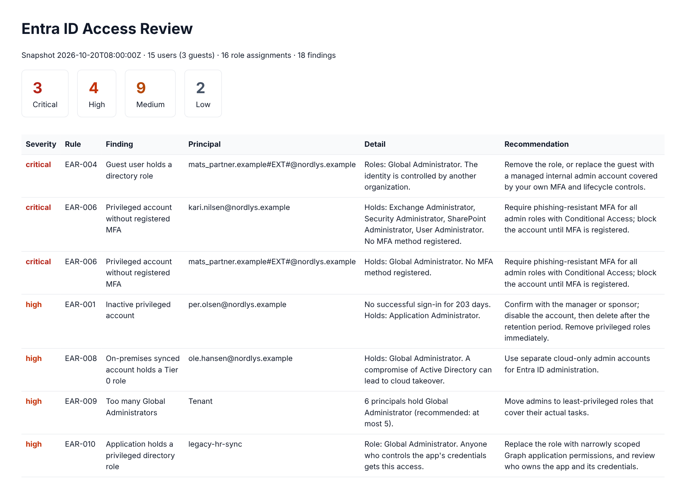

# Entra ID Access Review

A read-only Python tool that pulls users, directory role assignments and MFA registration from
Microsoft Entra ID through Microsoft Graph, and flags access risks: inactive accounts, over-privileged
users, guest users with admin rights and standing Tier 0 access.

It automates the kind of periodic access review an IGA team runs: collect the access data, apply
policy rules, and give each finding a severity and a concrete recommendation.



## What it checks

| Rule | Finding | Severity |
|---|---|---|
| EAR-001 | Enabled account with no successful sign-in for 90+ days (higher if privileged) | medium / high |
| EAR-002 | Account created 30+ days ago that has never signed in | medium |
| EAR-003 | Disabled account that still holds directory roles (leaver process gap) | medium |
| EAR-004 | Guest user with a directory role | high / critical |
| EAR-005 | Guest invitation never accepted after 30+ days | low |
| EAR-006 | Privileged role holder with no registered MFA method | critical |
| EAR-007 | Permanent Tier 0 assignment instead of just-in-time access through PIM | medium |
| EAR-008 | On-premises synced account holding a Tier 0 role | high |
| EAR-009 | Too many (more than 5) or too few (fewer than 2) Global Administrators | high / low |
| EAR-010 | Application (service principal) holding a privileged directory role | medium / high |
| EAR-011 | Account accumulating 3+ privileged roles (role creep) | medium |
| EAR-012 | Tier 0 role granted through group membership | low |

Tier 0 means Global Administrator, Privileged Role Administrator and Privileged Authentication
Administrator. Roles granted through role-assignable groups are expanded to the group's transitive
members, so indirect access is reviewed too.

## Quick start (no Azure needed)

```bash
pip install -e .
entra-access-review --demo
```

This runs against a bundled fictional tenant (`src/entra_access_review/data/sample_tenant.json`) and writes
`reports/findings.csv`, `reports/findings.json` and `reports/report.html`.

## Running against a real tenant

1. Create an app registration in Entra ID and add a client secret.
2. Add these **application** permissions for Microsoft Graph and grant admin consent:

   | Permission | Used for |
   |---|---|
   | `User.Read.All` | Users and guest status |
   | `RoleManagement.Read.Directory` | Directory role assignments |
   | `GroupMember.Read.All` | Expanding role-assignable groups |
   | `AuditLog.Read.All` | Last sign-in and MFA registration (Entra ID P1) |
   | `RoleEligibilitySchedule.Read.Directory` | PIM eligible assignments (Entra ID P2, optional) |

   All permissions are read-only. If the tenant lacks P1/P2 licences, the tool skips the checks
   that depend on that data and logs a warning instead of failing.

3. Run:

```bash
export AZURE_TENANT_ID=... AZURE_CLIENT_ID=... AZURE_CLIENT_SECRET=...
entra-access-review --save-snapshot snapshot.json --break-glass breakglass-01@contoso.com
```

Treat the snapshot and reports as confidential: they list accounts and their privileges.

### Options

| Option | Description |
|---|---|
| `--demo` | Use the bundled sample tenant |
| `--snapshot FILE` | Analyse a saved snapshot offline (e.g. to compare reviews over time) |
| `--save-snapshot FILE` | Save the raw collected data |
| `--inactive-days N` | Inactivity threshold (default 90) |
| `--break-glass UPN` | Documented emergency access account, not flagged for standing access (repeatable) |
| `--fail-on SEVERITY` | Exit with code 2 if any finding is at or above this severity, for scheduled runs or pipelines |
| `--out DIR` | Output folder (default `reports`) |

## Design

```
graph_client.py   OAuth 2.0 client credentials (MSAL), paging and retry on throttling (HTTP 429)
collector.py      Builds a normalized snapshot: users, role assignments (active + PIM eligible), MFA
rules.py          Each rule is a pure function from snapshot to findings
report.py         Console, CSV, JSON and HTML output
```

Collection and analysis are separate, so the rules can be tested without network access and a
snapshot can be re-analysed later. New rules are added by writing a function and adding it to `RULES`.

## Tests

```bash
pip install -e ".[dev]"
pytest
```

The tests cover every rule and run the collector against a fake Graph client, including the
fallback when premium data is not available. GitHub Actions runs linting, tests and the demo on every push.

## Ideas for further work

- Compare two snapshots and report new privileged access since the last review
- Check Conditional Access policies for admin MFA enforcement
- Review app registrations with expiring or long-lived client secrets
- Send findings to a SIEM or open tickets for owners automatically
